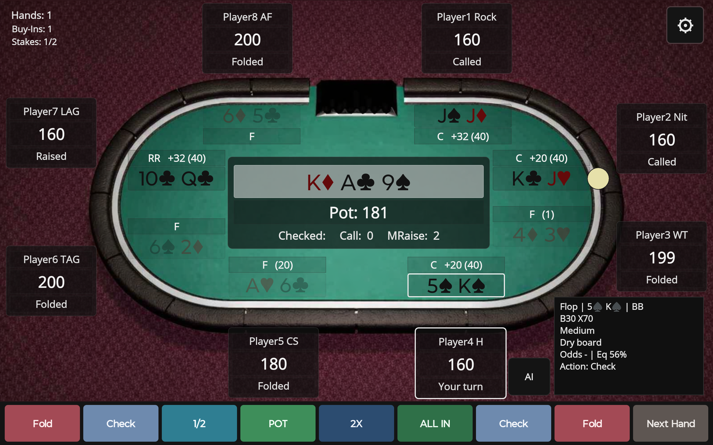
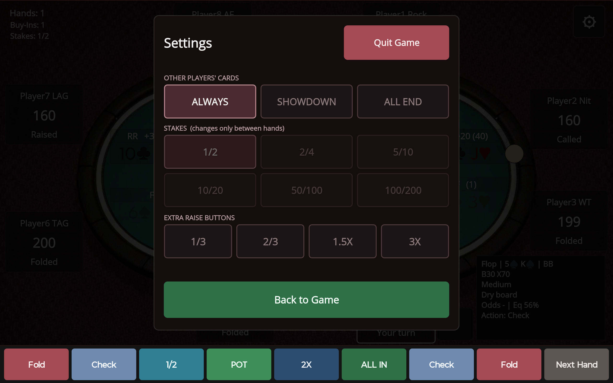
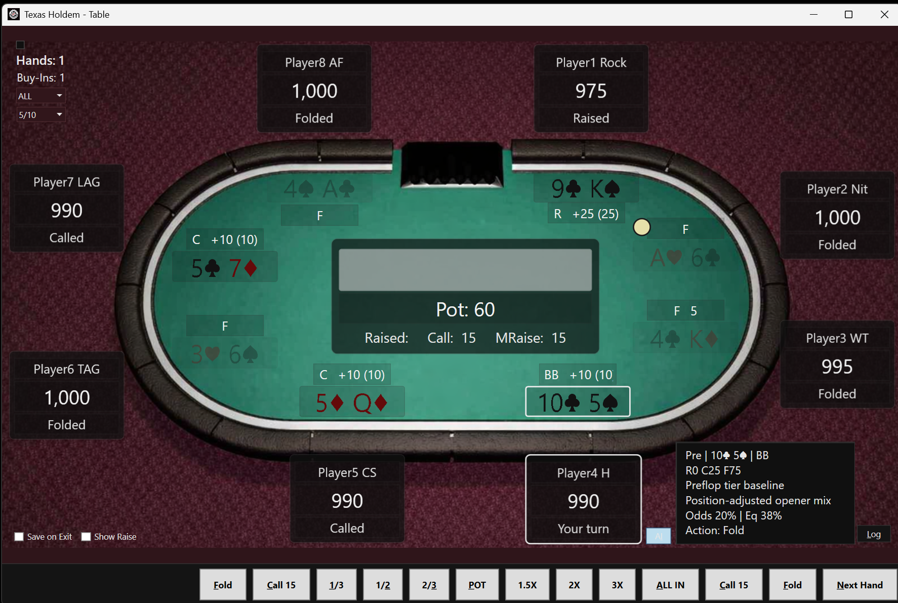

# How to play Texas Hold'em

[Back to the project](../README.md)

Play against seven computer opponents on [Android](#android-tablet) or [Windows](#windows-desktop). The table uses practice chips. You are **Player4 H**, near the bottom of the table.

## The hand in a minute

Each player gets two private cards. Up to five shared cards appear in the middle: three on the **flop**, one on the **turn**, and one on the **river**. There is a betting round before the flop and after each of those stages.

Make the best five-card hand from your two cards and the shared cards. You may use both, one or neither of your private cards. You win by having the best hand at showdown, or by being the last player who has not folded.

From strongest to weakest: straight flush (a royal flush is the highest), four of a kind, full house, flush, straight, three of a kind, two pair, one pair, high card. An Ace can be high or low in a straight, but a straight cannot wrap around from King through Ace to 2.

The yellow dealer marker moves around the table. The small and big blinds are forced opening bets. At **1/2** stakes, they are 1 and 2 chips, and each starting stack is 200 chips. Other stakes also start at 100 big blinds. Players who run out receive another buy-in; your **Buy-Ins** counter tracks yours.

## Android tablet

1. Open the game in landscape. Tap the **gear** to choose stakes and how much of the opponents' cards you want to see.
2. Tap **Back to Game**, then **Start Game**.
3. When your seat says **Your turn**, use the action buttons along the bottom.
4. Tap **AI** beside your seat to show or hide advice. The panel updates as you play.

This picture uses **Always** for the other players' cards. Folded players' cards are dimmed. The centre shows the shared cards, pot, amount to call and minimum raise increment (**MRaise**).

### Buttons and the Fold shortcut

The Fold and Check/Call buttons appear at both ends of the action bar so you can use either side.

| Control | What it does |
| --- | --- |
| **Check / Call** | Checks when nothing is owed, or calls the amount shown. If you have fewer chips, it calls with what you have. |
| **Fold**, facing a bet | Gives up your hand. The other players finish the hand, then the game pauses for review. |
| **Fold**, when checking is free | Checks. It does not throw away a free hand. |
| **Fold**, between hands | Deals the next hand. Either Fold button works, even though it looks dimmed on Android. |
| **1/2**, **POT**, **2X** and other size buttons | Immediately submit a bet or raise based on the current pot, subject to the legal minimum and your available chips. There is no second confirmation. |
| **ALL IN** | Commits your available chips when a raise is allowed, or calls when only a call is available. |
| **Next Hand**, between hands | Deals the next hand. |
| **Next Hand**, during your decision | Folds your current hand and skips the end-of-hand pause. Use this when you want to move on without reviewing the result. |

**To keep playing from the same button:** tap Fold when you want to give up a hand, wait for the hand to finish, then tap Fold again to deal the next one. If no bet is facing you, that first tap checks instead.

The size labels target your total bet for the current betting round as a fraction or multiple of the pot already on the table. For example, with a pot of 100, **1/2** targets a total bet of 50; chips you already put into that round count toward it. The minimum legal raise or your remaining stack can change the actual amount.

On Android, very fast repeated taps are ignored briefly to prevent one tap sequence from acting on two decisions. Wait for the next decision to appear before tapping again. Next Hand does not skip through a live hand while the opponents are still acting.

### Settings

| Other players' cards | What you see |
| --- | --- |
| **Always** | Everyone's cards throughout the hand, including dimmed cards from folded players. |
| **Showdown** | Your cards during play; opponents' cards are revealed if they reach showdown. |
| **All End** | Your cards during play; everyone's cards when the hand ends, including folded players. |

**Stakes:** choose 1/2, 2/4, 5/10, 10/20, 50/100 or 100/200. Stakes can change before starting or between hands. They are dimmed during a live hand. Changing stakes between hands and pressing **Back to Game** ends that session; press **Start Game** for fresh stacks at the new stakes.

**Extra raise buttons:** tap **1/3**, **2/3**, **1.5X** or **3X** to show or hide it on the action bar. The standard 1/2, POT, 2X and ALL IN buttons remain available.

**Quit Game:** closes the app. Android remembers your stakes, card visibility and extra-button choices. It does not save the current hand or chip stacks for a later session. Use Back to Game to return to the table without quitting.

### Read the AI panel

The advice is computed on your device. It does not play your hand for you.

| Display | Meaning |
| --- | --- |
| **Pre / Flop / Turn / River** | The stage of the hand. |
| **BTN, SB, BB** | Dealer/button, small blind and big blind. Other position labels describe seats acting earlier or later around the table. |
| **R / C / F / B / X** | Raise, call, fold, bet and check. Numbers beside the letters are suggested percentages, such as **B30 X70** for 30% bet and 70% check. |
| **Odds** | The share of the pot you must pay to call. A dash appears when no call is needed. |
| **Eq** | A rough estimate of your hand's equity. It is a heuristic estimate, not an exact calculation against the opponents' visible cards. |
| **Action** | The suggested play. You choose which button to press. |

The panel also describes your hand and the board. A **dry** board has fewer obvious straight or flush possibilities; a **wet** board has more. After a hand it shows a result summary: **Net** is your chip gain or loss, **Pot** is the pot total, and **Inv** is the chips you put in.

## Windows desktop

Open `TexasHoldem.exe`, choose the stakes and card visibility from the controls at the upper left, and click **Start Game**. The Fold, Check/Call, sizing and between-hand shortcuts work as described above.

Windows adds these mouse and keyboard controls:

| Control | What it does |
| --- | --- |
| **ALL / Human / Peek** | Show everyone's cards, show only yours, or reveal opponents' cards while the mouse hovers over them. These are the Windows choices; Android uses Always, Showdown and All End. |
| **AI** | Show or hide advice beside your seat. |
| **Log** | Show or hide the action history. The Android table does not expose this button. |
| **Show Raise** | Show or hide a custom amount box and its Raise button. The amount is the raise increment above the current bet; any call you owe is paid as well. Legal minimums and your remaining chips still apply. |
| Small square at the upper left | Toggle the computer-decision diagnostic log. Black is off; white is on. This writes `ai_decisions.log` locally and is separate from the on-table Log panel. |
| Right-click an opponent's name | Choose that opponent's playing style between hands. Android uses the fixed lineup. |
| **Save on Exit** | Remember window placement and selected display/settings choices. It does not save the current hand or chip stacks. |

Changing stakes between hands ends the current session. Click **Start Game** to begin at the new stakes.

The small labels by each seat show the last action and chips put in: **SB/BB** for blinds, **B** for bet, **R/RR** for raise/re-raise, **C** for call, **X** for check and **F** for fold. The number in parentheses is that player's contribution to the hand so far. These labels appear on Android too.

### Keyboard shortcuts

Use these keys without Ctrl or Alt. They do not trigger while you are typing in an editable text box. Betting keys act immediately when it is your turn.

| Key | Action |
| --- | --- |
| **S** | Start a game. |
| **F** or **Space** | Fold, check when free, or deal the next hand during the pause. |
| **C** | Check or call. |
| **P** or **R** | POT bet/raise. |
| **A** | All in. |
| **N** | Next Hand, including folding and skipping the pause when it is your decision. |
| **1 / 2 / 3** | 1/3, 1/2 or 2/3 pot. |
| **4 / 5 / 6** | 1.5X, 2X or 3X pot. |
| **I** | Toggle AI advice. |
| **L** | Toggle the action log. |
| **Q** | Quit. |

The number pad works for the six size shortcuts too.

## Meet the opponents

| Label | Playing style |
| --- | --- |
| **Rock** | Very selective and usually cautious. |
| **Nit** | Waits for strong starting hands. |
| **WT** | Weak-tight: selective, but easier to push off a hand. |
| **CS** | Calling station: calls often. |
| **TAG** | Tight-aggressive: selective, then applies pressure. |
| **LAG** | Loose-aggressive: plays more hands and raises often. |
| **AF** | Aggressive fish: loose and aggressive with less discipline. |

Windows also lets you select **Reg**, a balanced regular, or **Maniac**, a very aggressive opponent. The styles affect tendencies; they do not guarantee a particular action.
