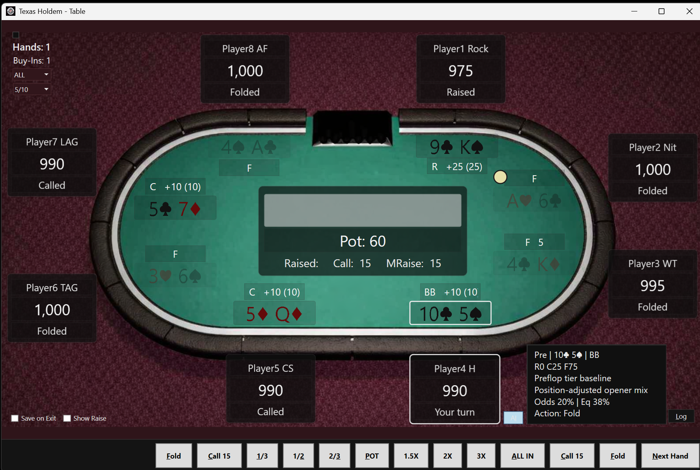

# Texas Hold'em

Play no-limit Texas Hold'em against seven computer opponents, each with a style of its own: the rock who waits for premium hands, the calling station who never folds, the loose-aggressive player who raises with anything. Learn to read them, and when you are unsure, an advice panel shows the play it would make and why.

Runs as a Windows desktop app and as an Android app, one file each, nothing to install. Everything happens on your device: no account, no internet connection, no ads, no tracking. Nothing you do at the table ever leaves your machine.



## Download

Ready-to-run builds are on the [Releases page](https://github.com/Edge358/TexasHoldem/releases): a Windows zip and an Android APK, both signed. Windows: unzip and run `TexasHoldem.exe`. Android: allow installs from unknown sources, then open the APK.

## The game

- You sit at an eight-seat table against seven AI players: a nit, a rock, a tight-aggressive, a loose-aggressive, a calling station, a weak-tight player and an aggressive fish. They play differently and you can learn to read them.
- Stakes from 1/2 up to 100/200, chosen before each session. Stacks start at 100 big blinds.
- Bet sizing buttons for 1/3, 1/2, 2/3 and full pot, 1.5x, 2x, 3x and all in, next to the usual Fold, Check/Call and Raise.
- An advice panel suggests a play for your hand on each street, with the reasoning and your pot odds and equity. Use it to learn, or ignore it.
- You choose whether the other players' cards are shown. On Windows: all cards, your cards only, or peek on hover. On Android: always, at showdown, or for everyone when the hand ends.
- A hand log records every action.

## Two apps, one engine

| App | Project | Target |
| --- | --- | --- |
| Windows desktop (WPF) | `UI/TexasHoldem.UI.Wpf` | .NET 8, Windows |
| Android (.NET MAUI) | `UI/TexasHoldem.UI.Maui` | .NET 9, Android 5.0 and later |
| Console (legacy) | `UI/TexasHoldem.UI.Console` | .NET 8 |

Both apps share:

- `TexasHoldem.Logic`: cards, hand evaluation, betting rules and the game loop.
- `AI/TexasHoldem.AI.SmartPlayer`: the opponents and the advice engine. `AI/TexasHoldem.AI.DummyPlayer` is a simple baseline player.
- `TexasHoldem.Presentation`: the table-view and human-player contracts both UIs implement.

The Android app copies the Windows table layout and is meant to be sideloaded onto a tablet. It is not in any app store.

## Building

Windows desktop app:

```
dotnet build TexasHoldem.sln
dotnet run --project UI/TexasHoldem.UI.Wpf
```

Or open `TexasHoldem.sln` in Visual Studio 2022 and run `TexasHoldem.UI.Wpf`.

Android app. You need the .NET 9 SDK with the `android` workload (installed by the Visual Studio ".NET Multi-platform App UI development" workload) and an Android SDK with platform 35.

```
dotnet build UI/TexasHoldem.UI.Maui -f net9.0-android
```

For a release build to install on a device, publish for `android-arm64` and sign it with your own keystore:

```
dotnet publish UI/TexasHoldem.UI.Maui -f net9.0-android -c Release -p:RuntimeIdentifier=android-arm64
```

Tests:

```
dotnet test Tests/TexasHoldem.Logic.Tests
```

`Tests/TexasHoldem.Tests.GameSimulations` is a console program that plays the AI players against each other over many hands.

## Documentation

- `Docs/TexasHoldem_BluePrint.md`: how the engine, the WPF table and the AI panel fit together.
- `Docs/aiResponse.md`: the format and tiers behind the advice panel.
- `Docs/ToDo`: feature plans not yet built.
- `AGENTS.md`: build and style notes for coding agents.

## Credits and license

The engine and the AI player framework began from Nikolay Kostov's [TexasHoldemGameEngine](https://github.com/NikolayIT/TexasHoldemGameEngine) (MIT). The desktop and Android apps, the opponent profiles, the advice engine and the shared presentation layer were written for this project. See `THIRD_PARTY_NOTICES.txt` for all dependencies.

This project is released under the [MIT License](LICENSE).
